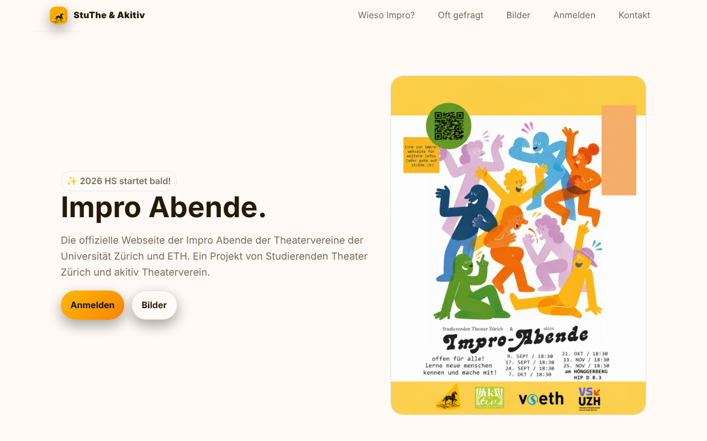

# Impro-Abende – StuThe & akitiv

Website for the improv theatre evenings of **Studierenden Theater Zürich
(StuThe)** and **akitiv Theaterverein**, open to all students of the University
of Zurich and ETH. Live at [studi-impro.ch](https://www.studi-impro.ch).



A single-page static site in German, written in plain HTML, CSS and
JavaScript and hosted with GitHub Pages.

## Sections

- **Wieso Impro?** – why improv theatre
- **Oft gefragt** – FAQ
- **Bilder** – photos
- **Anmelden** – how to join, including a WhatsApp group QR code
- **Kalender** – semester dates
- **Kontakt** – contact (e-mail address obfuscated against spam bots)

## Highlights

- Responsive layout with breakpoints for tablet and mobile
- No dependencies or build step – easy for the next committee to maintain

## Structure

```
├── index.html     the whole site
├── *.png / *.jpg  logos, flyer, photos and QR code
├── docs/          screenshot for this README
└── CNAME          custom domain for GitHub Pages
```

## Run locally

Open `index.html` in a browser, or run `python -m http.server` in this folder.
